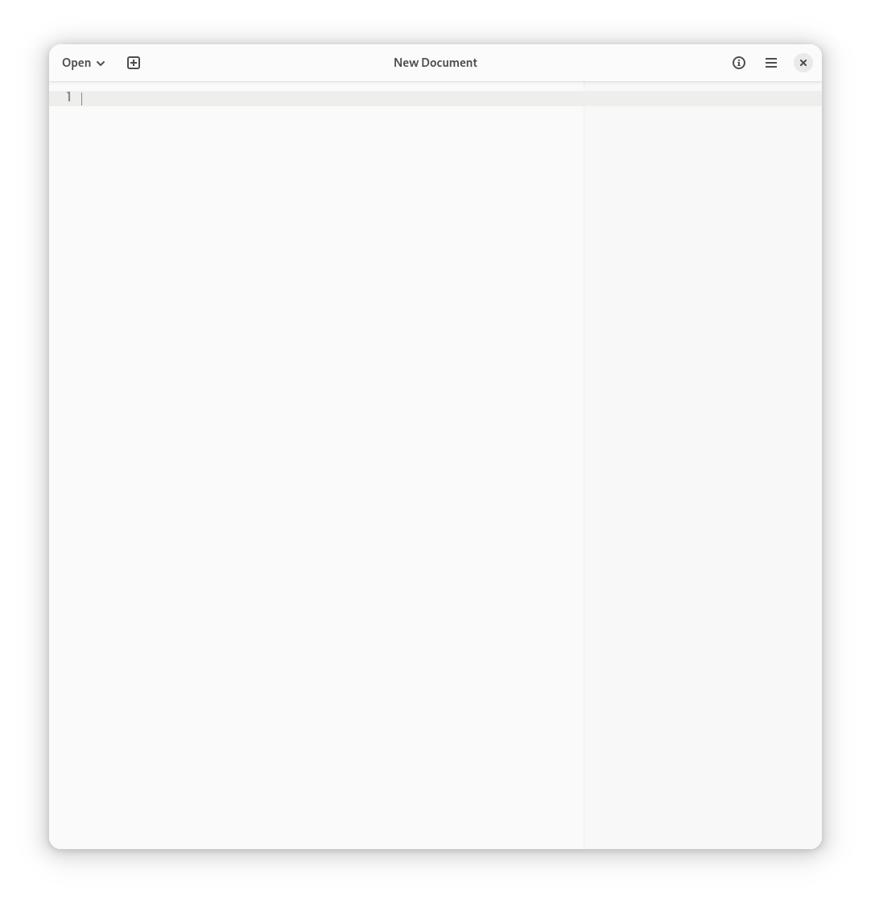
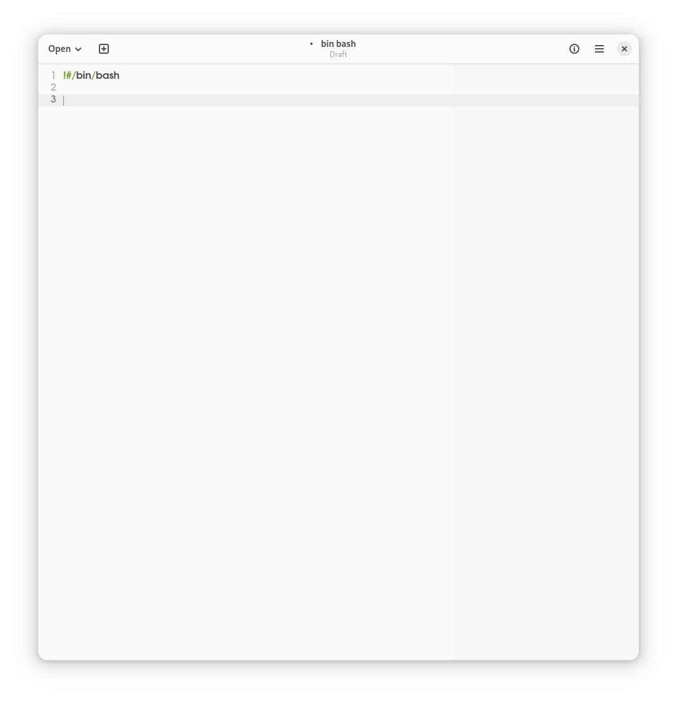
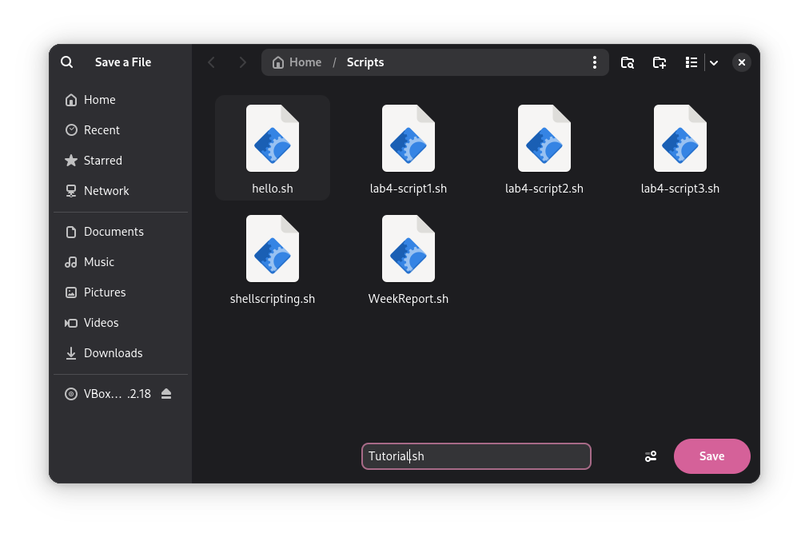
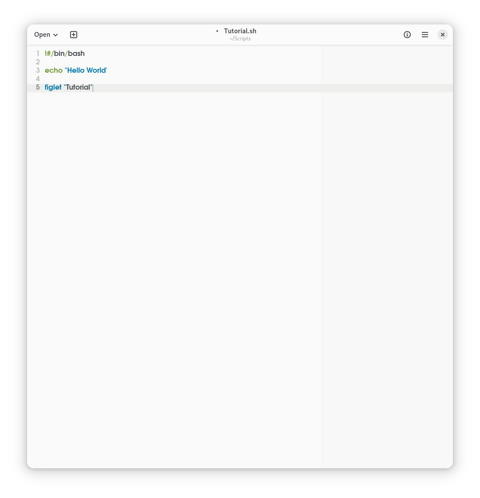
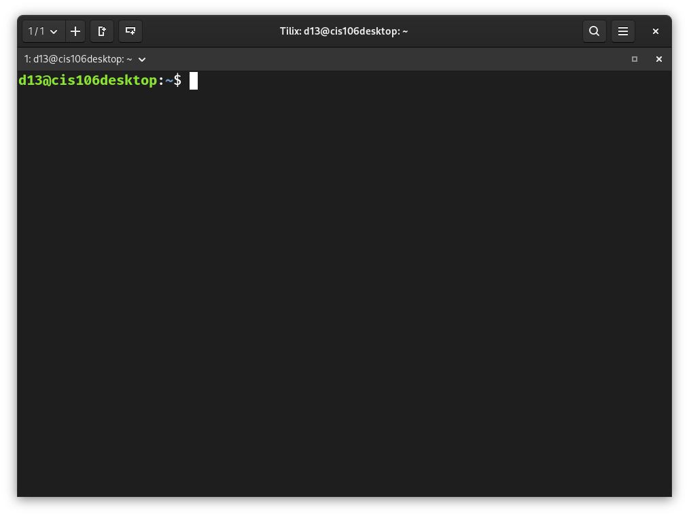
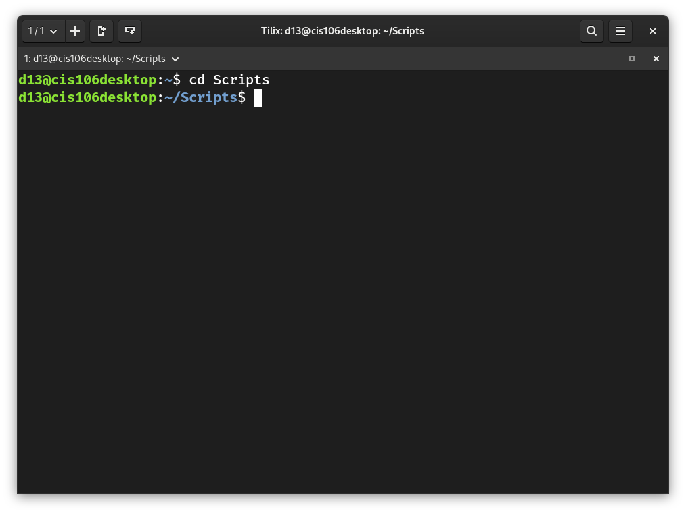
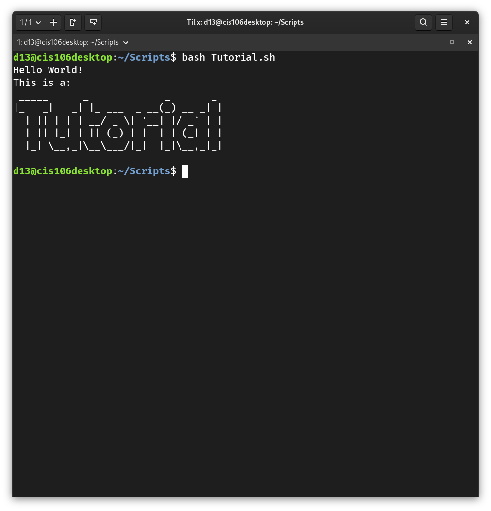

# Notes 4 Submission 

#### How to install and remove software using the APT command. 

* When installing and removing software, the sudo command must be used first, followed by the "apt" then "install" or "remove" depending on the desired command. 
  * example 1: (install software)
  ```
  sudo **apt** install bastet
  ``` 
  * example 2:(delete software)
   ```
   sudo **apt** remove bastet
    ```

#### How to create a shell script step by step including screenshots and how to run it. 
  SHELL SCRIPTING 
1. Open text editor 
            
 2. Declare shell interpreter 
            
3. Save file under descriptive name 
            
4. Add commands 
        
5. Save the script 
   1. Unsaved (black dot)
             
    2. Saved
            
6. Open terminal 
            
7. Locate the location of shell script using cd command 
            
8. Run the script using the bash command 
            